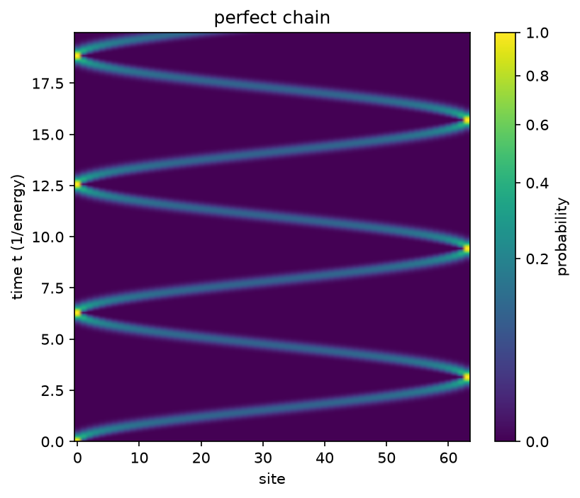
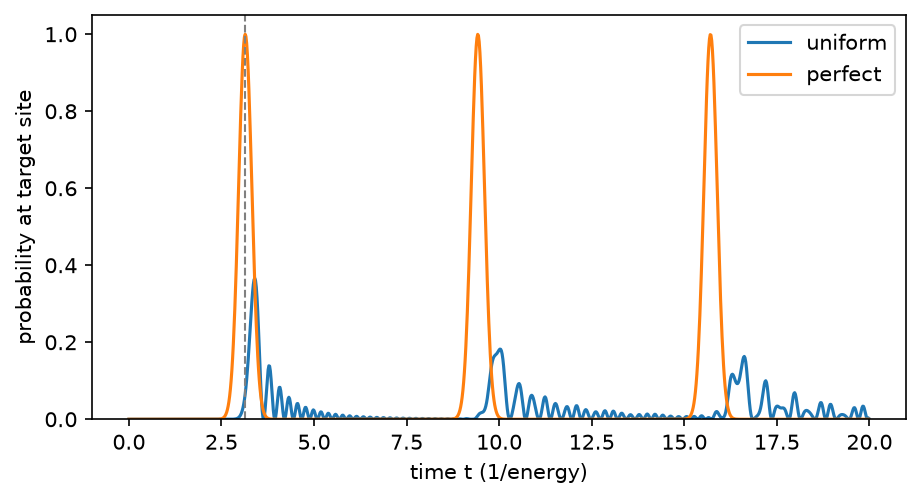
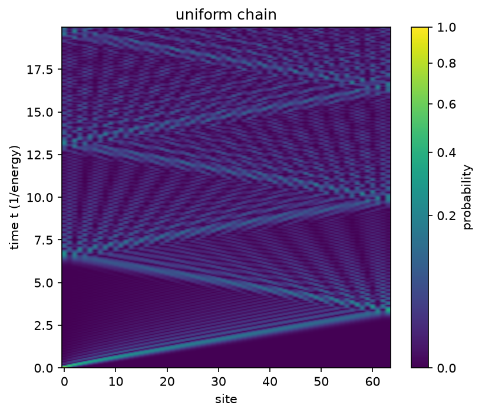

# Quantum State Transfer


Exact simulation of a single quantum excitation hopping along a 1D chain
(a tight-binding model, equivalent to one excitation in an XX spin chain).
Units: hbar = 1, so energies are in 1/time. Compares a uniform chain with the
"perfect state transfer" chain of Christandl et al.



## Physics
- The state starts on site 0. The Hamiltonian is a real-symmetric tridiagonal
  matrix H; the state at time t is exp(-iHt) acting on the start state, computed
  exactly from the eigendecomposition of H.
- **Uniform chain** (equal couplings): the excitation *disperses* (the
  probability spreads like Bessel functions), reflects off the ends, and never
  refocuses (best last-site probability about 0.37). A constant on-site energy
  only adds a global phase and does not change any probability.
- **Perfect chain** (couplings J_j = (lam/2) sqrt(j (N - j))): the energy levels
  are exactly evenly spaced, so the wave refocuses and arrives on the last site
  with probability 1 at t = pi/lam, then returns at 2 pi/lam.

## Results
| Chain | Best last-site probability | Time |
|---|---|---|
| Uniform (N=64, J=10) | about 0.37 | t = 3.4 |
| Perfect (N=64, lam=1) | 1.0 | t = pi |




## Install and run
```bash
git clone git@github.com:RoshCoding/Quantum-State-Transfer.git
cd Quantum-State-Transfer
uv sync
uv run python -m qst --chain perfect --dt 0.01 --steps 400
uv run python -m qst.plotting     # regenerate figures in media/
uv run pytest                     # run the tests
```

## Testing
The tests check norm conservation, perfect transfer at t = pi, agreement with the
analytic Bessel-function solution of the uniform chain, and agreement with the
output of the original C code.

## History and credits
The original C + LAPACK version is preserved at tag `v1.0-cosmos`, originally developed in the UC Davis COSMOS program (with the guidance of Prof. Scalettar).

## Reference
M. Christandl, N. Datta, A. Ekert, A. J. Landahl, *Perfect State Transfer in
Quantum Spin Networks*, Phys. Rev. Lett. 92, 187902 (2004).

## License
MIT (see LICENSE).
